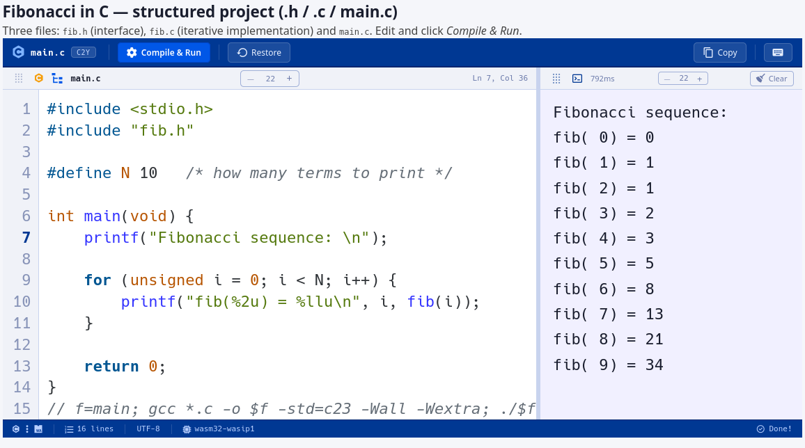

# CWASM

A **C compiler in the browser**, built **from source**: clang + lld compiled to
WebAssembly, running in a Web Worker, with a self-contained WASI host and an
editor/terminal widget for teaching pages.

It compiles, links, and runs C **entirely on the client** — no compile server,
no backend. Built for course material (it originates from the INE5201 course),
but usable on any page.



---

## ⚠️ Tested version and future compatibility

This repository was **tested** with the following combination:

| component | tested version |
|---|---|
| LLVM / Clang / LLD | **llvmorg-23.1.6** |
| wasi-libc | **wasi-sdk-34** |
| compile target | **`wasm32-wasip1`** (long/pointer/size_t = 32-bit) |
| default C standard | **C2Y** (`-std=gnu2y`) — the newest the clang accepts |
| browser | recent Chrome/Edge and Firefox, with **COOP/COEP** enabled |

The scripts track **the latest stable LLVM automatically** (`resolve_llvm_tag`).
Because of that, **future LLVM/wasi-libc versions will likely require
adaptations** — mainly in the anchors of `scripts/source-fixups.sh` and the
shims in `scripts/shim/`. The build is designed to absorb those changes outside
LLVM (no patch to the LLVM source), but there is no guarantee that a future
major will compile without adjustment. When updating, expect to revisit the
fixups.

To reproduce the exact tested version:
```bash
LLVM_TAG=llvmorg-23.1.6 ./scripts/install-deps.sh
./scripts/build-toolchain.sh
```

---

## How it works (3 layers)

1. **In-browser compiler** — `clang.wasm` + `lld.wasm` (compiled to
   `wasm32-wasi`). clang runs `cc1` in-process (`CLANG_SPAWN_CC1=OFF`) and
   `wasm-ld` performs the link.
2. **WASI runtime** — `web/worker.js` is a self-contained
   `wasi_snapshot_preview1` host: an in-memory filesystem (hosts the sysroot and
   the temporaries) and interactive `stdin` over `SharedArrayBuffer` + `Atomics`.
3. **Student sysroot** — `sysroot.tar`: wasi-libc + compiler-rt builtins
   (includes binary128 softfloat → real `long double`) + headers.

The public layer (`cterminal.js`, `cterminal.css`, `scriptExec.cwasm.js`,
`execCWASM.js`) is the editor/terminal and the glue that talks to the worker.

> **C only.** The student sysroot ships only the C library. C++ (`<iostream>`…)
> is not available for student programs yet.

---

## Build

Prerequisites (Debian/Ubuntu): `cmake ninja-build build-essential python3 git brotli`
(the host clang is downloaded as the official LLVM prebuilt of the same resolved
version; apt clang is only a fallback).

```bash
./scripts/install-deps.sh      # resolve LLVM (latest stable) + wasi-libc; fetch sources
./scripts/build-toolchain.sh   # produce web/assets/{clang.wasm,lld.wasm,sysroot.tar} (+ .br/.gz, manifest.json)
```

The build is **long** (hours, tens of GB of disk) and runs offline. It is fully
reproducible: `rm -rf .src .build && ./scripts/install-deps.sh` recreates
everything.

The binaries are **not kept in git** (see `.gitignore`): produce them with the
build above (they land in `web/assets/`), or drop prebuilt binaries there
yourself. See `web/assets/README.md`.

---

## Using it on a page

Include the public layer and declare a widget with `class="cterminal"`:

```html
<link rel="stylesheet" href="/path/cterminal.css">
<script src="/path/scriptExec.cwasm.js"></script>
<script src="/path/cterminal.js"></script>

<div class="cterminal" data-filename="main.c" data-terminal-position="right"
     data-editor-lines="15" data-cflags="-Wall -Wextra">
  <script type="text/plain">
#include <stdio.h>
int main(void) { printf("hello, world\n"); return 0; }
  </script>
</div>
```

- `data-cflags` — flags passed to clang (e.g. `-std=c17 -Wall -Wextra`). Without
  `-std`, the default from `manifest.json` is used (currently C2Y).
- Multiple files: add `<script type="text/plain" data-filename="x.h">` / `.c`.
  A complete, structured example is in
  [`example.html`](example.html).

`scriptExec.cwasm.js` derives the `web/worker.js` path from its own
`<script src>`, so the folder can be moved without reconfiguring.

---

## Serving with COOP/COEP (required)

`SharedArrayBuffer` requires a **cross-origin isolated** context
(`crossOriginIsolated`). The server must send:
```
Cross-Origin-Opener-Policy: same-origin
Cross-Origin-Embedder-Policy: require-corp      (or credentialless)
```
Without these headers, nothing compiles.

> **GitHub Pages** does not let you set headers — a demo hosted at `*.github.io`
> **will not run** unless you inject the headers on the client with a service
> worker (the `coi-serviceworker` pattern). On your own server (nginx/apache),
> just configure the headers above.

---

## Local testing

Serve the **repository root** and open **`/example.html`**. The page references
`cterminal.css`, `scriptExec.cwasm.js`, etc. as siblings and the worker as
`web/worker.js`, so everything resolves from the root. Never pass `example.html`
as a server argument — that turns it into a *router* and every request comes
back as HTML.

**Render only** (the editor/terminal UI, e.g. for a screenshot) — any static
server works, no special headers needed:
```bash
python3 -m http.server 8080     # then open http://localhost:8080/example.html
php -S localhost:8080           # (no file argument!)
npx serve -l 8080
```

**Compile & Run** needs `crossOriginIsolated` (`SharedArrayBuffer`), so the
server must also send the COOP/COEP headers above. The plain servers don't — the
widget renders but won't compile. Use one of:

`router.php` at the repo root, served explicitly (here the router is intentional):
```php
<?php
header('Cross-Origin-Opener-Policy: same-origin');
header('Cross-Origin-Embedder-Policy: require-corp');
$p = parse_url($_SERVER['REQUEST_URI'], PHP_URL_PATH);
return ($p !== '/' && is_file(__DIR__ . $p)) ? false : true;
```
```bash
php -S localhost:8080 router.php
```

`coi-serve.py` at the repo root:
```python
import http.server, socketserver
class H(http.server.SimpleHTTPRequestHandler):
    def end_headers(self):
        self.send_header('Cross-Origin-Opener-Policy', 'same-origin')
        self.send_header('Cross-Origin-Embedder-Policy', 'require-corp')
        super().end_headers()
socketserver.TCPServer(('127.0.0.1', 8080), H).serve_forever()
```
```bash
python3 coi-serve.py
```

Notes:
- `web/assets/{clang.wasm,lld.wasm,sysroot.tar}` must be present (build them or
  drop them in). The first compile downloads ~160 MB, then it is cached.
- Check `crossOriginIsolated === true` in the DevTools console; verify the
  headers with `curl -I http://localhost:8080/example.html | grep -i cross-origin`.
- VS Code Live Server and `npx http-server` render fine but don't send
  COOP/COEP, so they won't compile.

---

## Layout

```
CWASM/
├─ scripts/            install-deps.sh, build-toolchain.sh, source-fixups.sh, shim/
├─ web/
│  ├─ worker.js        WASI preview1 host (in-browser runtime)
│  └─ assets/          populated by the build (binaries out of git) + manifest.json
├─ cterminal.js/.css   editor + terminal
├─ scriptExec.cwasm.js widget ↔ worker glue
├─ execCWASM.js
├─ example.html        self-contained demo (fib.h / fib.c / main.c)
├─ example.png         screenshot (shown in this README)
├─ LICENSE             MIT (first-party code)
└─ THIRD_PARTY_LICENSES.md   LLVM / wasi-libc (distributed binaries)
```

---

## License

First-party code under **MIT** (see [`LICENSE`](LICENSE)). The toolchain binaries
(`clang.wasm`, `lld.wasm`, `sysroot.tar`) are builds of LLVM and wasi-libc and
keep their original licenses — see
[`THIRD_PARTY_LICENSES.md`](THIRD_PARTY_LICENSES.md).
